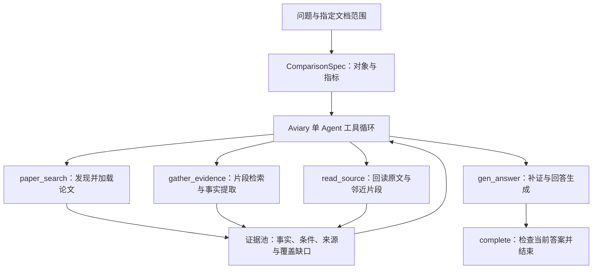
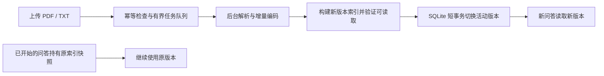

# PaperQA

**让论文对照回答带上实验条件、证据缺口与可回查的原文来源。**

[](pyproject.toml)
[](LICENSE)

PaperQA 是面向本地论文研读与实验对照的 Agent 应用，基于 [Future-House/paper-qa](https://github.com/Future-House/paper-qa) 二次开发。上传 PDF/TXT 后，可以用中文查找英文论文中的实验指标，比较不同方法的条件与结果，并沿来源回查原文。提供 Web 页面、FastAPI 接口与命令行。

项目保留单 Agent 工具调查的主线，围绕混合检索、结构化证据、定向补证和本地索引服务做了重构。适合需要反复查阅一组论文、核对实验条件的个人资料库。

**核心技术**：Python、FastAPI、Pydantic、asyncio、Aviary、Tantivy、E5、CrossEncoder、PyMuPDF、SQLite、Redis（可选）。

[快速开始](#快速开始) · [命令行](#命令行) · [调查流程](#调查流程) · [索引与缓存](#索引与缓存) · [API 使用](#api-使用) · [项目结构](#项目结构)

## 可以做什么

| 能力 | 实现方式 |
| --- | --- |
| 跨语言检索 | 多语 E5 与 Tantivy BM25 双路召回，通过 RRF 融合排序 |
| 两级检索 | 先发现相关论文，再在已加载资料中定位证据片段 |
| 实验条件对照 | 按对象、指标、取值、单位与条件组织事实，标记缺项和冲突 |
| 定向补证 | 根据覆盖缺口局部改写查询、加载目标论文、定位表格，按需 CrossEncoder 重排 |
| 来源回查 | 保留文档、片段、页码和原文引用，支持读取邻近片段与查看原始文件 |
| 后台入库 | 有界后台任务处理解析与建索引，提供入库状态查询和独立问答会话 |
| 索引版本发布 | 构建新版本后原子切换，在途问答继续使用自己持有的版本 |
| 增量与缓存 | 复用解析结果和持久向量，可选 Redis 候选缓存、超时熔断与本地降级 |

## 快速开始

需要 [uv](https://docs.astral.sh/uv/)。项目声明支持 Python 3.11 及以上，仓库通过 `.python-version` 默认选择 Python 3.13。以下示例使用 PowerShell，在仓库根目录运行。

```powershell
git clone https://github.com/dbfbd/paperqa-agent.git
cd paperqa-agent
uv sync --locked --extra rag
$env:DEEPSEEK_API_KEY = 'your-key'
$env:PQA_SETTINGS = 'configs/rag-local.json'
uv run --locked --extra rag uvicorn app.api:app --host 127.0.0.1 --port 8000
```

打开 [本地页面](http://127.0.0.1:8000)，上传文本型 PDF 或 UTF-8 TXT，再提出问题。[交互接口文档](http://127.0.0.1:8000/docs) 提供请求参数和返回结构。

可以从以下问题开始，将方法名、指标和文档范围替换为实际内容：

> 比较这几篇论文中方法 A 与方法 B 在相同数据集上的实验结果，列出指标、训练条件和页码；条件不一致的结果请分别说明。

增强配置使用本地多语 E5，首次运行需要下载模型；触发重排时加载 CrossEncoder。仓库不包含论文、模型权重或 API 密钥。上传完成后，页面可展示回答、结构化结果与来源，原文可通过来源接口回查。

## 命令行

将资料放入仓库下的 `papers` 目录，依次建索引、检查解析结果和提问。

```powershell
uv run --locked --extra rag pqa index --settings configs/rag-local.json
uv run --locked --extra rag pqa inspect --settings configs/rag-local.json --reuse-index
uv run --locked --extra rag pqa ask --settings configs/rag-local.json --reuse-index --question '比较这些论文中各模型的实验条件和结果'
```

`inspect` 输出文档编号、片段数、表格数和解析警告，可先确认资料是否被正确读取。`ask` 将运行记录写入 `runs`，包含回答、工具历史、证据与用量。

- `--papers`：覆盖资料目录。
- `--index-name`：选择索引名称。
- `--reuse-index`：复用已有索引。
- `ask --spec`：传入 JSON 格式的对照要求。
- `ask --output`：设置运行结果目录。

Web 服务通过 `PQA_SETTINGS` 读取配置；CLI 使用 `--settings` 指定配置文件。两者使用相同的检索与 Agent 实现。

## 调查流程

系统先整理问题中的对照对象、指标与文档范围，再让单个 Agent 根据当前证据选择工具。一次检索后仍有关键缺项时，可以继续补查。



### 五类工具

| 工具 | 负责的工作 |
| --- | --- |
| `paper_search` | 从文档索引发现论文，将允许范围内的相关资料加载到当前会话 |
| `gather_evidence` | 按对象、指标和文档范围检索片段，提取带条件的事实并汇报缺项与冲突 |
| `read_source` | 读取指定片段及邻近原文，核对页码、语境和引用 |
| `gen_answer` | 按需补证，选择上下文预算内的证据，再生成对照回答 |
| `complete` | 检查回答是否对应当前证据状态，返回运行结果 |

### 如何处理证据不足

会话按“对象 × 指标”记录证据覆盖。事实除了数值，还保留单位、实验条件及文档、片段、页码和原文引用。重复事实合并，冲突或条件不一致的结果单独标记。

增强配置在生成回答前，针对缺项执行有预算限制的局部补证：聚焦对象与指标改写查询、加载目标论文、查找指定表格，并在需要时调用 CrossEncoder 重排。补证和重排均有次数或超时限制，失败时保留已有证据继续处理。

生成回答时按对象分配证据并记录因上下文预算未纳入的部分。新事实或原文读取会使旧答案失效，需要重新生成，避免把更新前的回答当作最终结果。

### 运行控制与输出

Agent 决策上下文保留当前结构化状态及近期工具轮次，模型请求统一统计调用量与 Token，并为最终回答预留预算。达到步骤、用量或时间限制时，返回当前进度和停止原因。

主要输出包括 `answer`、`result`、`documents`、`usage`、`tool_history`、`trace` 和 `stop_reason`。`status` 区分 `completed`、`partial`、`budget_exhausted`、`timeout`、`error`，`answer_is_current` 表示回答是否对应当前证据。

运行完成表示流程结束，答案质量仍需结合来源核对；当前 `quality_verified` 保持为 `false`。

## 索引与缓存

### 两级混合检索

文档发现使用 Tantivy 文档索引，并结合 E5 片段命中寻找相关论文；片段取证在当前文档范围内融合 BM25 与 E5 结果。RRF 汇合两路排名，保留各自对术语、缩写和跨语言语义的匹配能力。

向量在入库阶段预编码并持久化，查询复用向量矩阵。解析缓存按内容和解析配置识别，向量缓存按模型身份及文本哈希识别，增量构建只编码缺失片段。

### 后台入库与版本发布



入库在后台执行，问答使用独立会话与并发配额。新索引写入独立版本目录，通过 SQLite WAL 与短事务核对前置版本后发布；构建失败时继续保留上一发布版本。

上传可附带 `Idempotency-Key`：同一键与相同批次指纹复用任务，同一键对应不同内容返回冲突。已完成任务即使在后续发布或服务重启后重放，也返回它当时发布的版本。重启时未完成任务标记为失败，可使用新键重新提交。

### 可选 Redis 候选缓存

本地检索可以独立运行。已有 Redis 时，在同一个已设置 `PQA_SETTINGS` 的终端补充：

```powershell
uv sync --locked --extra rag --extra redis
$env:PQA_REDIS_URL = 'redis://127.0.0.1:6379/0'
uv run --locked --extra rag --extra redis uvicorn app.api:app --host 127.0.0.1 --port 8000
```

缓存按索引版本、模型身份、文档范围和查询参数隔离，仅保存候选片段编号与分数。读取时重新核对来源范围与片段有效性，默认 TTL 为 300 秒。

Redis 操作有总超时，连续失败触发熔断，冷却后通过单次探测恢复。缓存不可用时走本地检索，语义检索异常时保留 BM25 分支。

## API 使用

| 方法 | 路径 | 用途 |
| --- | --- | --- |
| `GET` | `/` | 本地交互页面 |
| `POST` | `/documents` | 上传 PDF/TXT；`wait=false` 时返回后台任务 |
| `GET` | `/ingestions/{job_id}` | 查询入库任务状态 |
| `GET` | `/documents` | 查看当前版本的资料列表与版本号 |
| `POST` | `/query` | 发起问答，可限定 `doc_ids` 与对照要求 `spec` |
| `GET` | `/sources/{doc_id}` | 查看或下载原始资料 |

### 异步上传与查询状态

```powershell
curl.exe -F 'files=@papers/example.pdf' -H 'Idempotency-Key: demo-upload-001' 'http://127.0.0.1:8000/documents?wait=false'
curl.exe 'http://127.0.0.1:8000/ingestions/JOB_ID'
curl.exe 'http://127.0.0.1:8000/documents'
```

替换文件路径与返回的 `JOB_ID`。入库状态为 `queued`、`building`、`ready` 或 `failed`，确认 `ready` 后发起问答。省略 `wait=false` 时，上传请求默认等待构建完成。

### Python 发起问答

```python
import httpx

response = httpx.post(
    "http://127.0.0.1:8000/query",
    json={"question": "比较已上传论文中各模型的实验条件与结果"},
    timeout=360,
)
response.raise_for_status()
result = response.json()
print(result["status"])
print(result["answer"])
print(result["index_version"])
```

返回的 `index_version` 对应本次问答固定使用的资料版本。需要只比较部分文档时，将 `/documents` 返回的编号作为 `doc_ids` 传入。

## 配置说明

[configs/rag-local.json](configs/rag-local.json) 是推荐的本地增强配置；[configs/default.json](configs/default.json) 提供较轻的基础配置。以下为增强配置及其继承默认值中的常用选项。

| 配置 | 当前值 | 作用 |
| --- | --- | --- |
| `model` | `deepseek/deepseek-flash` | 问答模型，可按兼容服务调整 |
| `embedding` | `local/intfloat/multilingual-e5-small` | 本地多语向量模型 |
| `index.paper_directory` | `papers` | 资料目录 |
| `index.index_directory` | `.paperqa-v1` | 索引、版本与缓存目录 |
| `index.pending_uploads` | `4` | 已接收且未完成的入库任务上限 |
| `agent.concurrent_queries` | `3` | 同时运行的问答上限 |
| `answer.evidence_k` | `8` | 证据检索规模 |
| `answer.context_chars` | `24000` | 回答阶段的证据文本预算 |
| `answer.rerank.enabled` | `true` | 允许定向补证中的重排 |
| `agent.gap_repair` | `true` | 允许回答前补查缺项 |
| `agent.max_steps` | `16` | Agent 最大决策步数 |
| `agent.max_calls` / `agent.max_tokens` | `60` / `120000` | 模型累计调用与 Token 预算 |

模型和重排器支持配置本地路径。变更解析或向量模型配置后，应重新构建索引。

## 项目结构

```text
app/
├── api.py                  FastAPI、并发配额与后台入库
└── static/index.html       本地问答页面
configs/                    基础配置与本地增强配置
src/paperqa/
├── agents/                 Aviary 工具循环、调查工具与定向补证
├── comparison.py           事实合并、条件检查与覆盖状态
├── docs.py                 会话文档、证据池与回答生成
├── retrieval.py            E5、BM25 与 RRF 检索
├── rerank.py               按需 CrossEncoder 重排
├── catalog.py              SQLite 索引版本、任务与幂等记录
├── cache.py                Redis 候选缓存与熔断
├── readers.py              PDF/TXT 解析与分块
├── table_layout.py         表格布局辅助解析
├── core.py                 会话状态与共享用量控制
└── cli.py                  命令行入口
```

## 适用范围

- 面向本地单服务进程和个人资料库，后台任务保存在进程内，任务状态与已发布索引持久化。
- 支持文本型 PDF 与 TXT。部分数值表格有布局辅助解析，复杂跨页表格、公式或扫描件需先核对解析结果。
- 对照能力取决于资料中能提取到的条件与证据，来源引用便于复核，不能替代人工判断。
- 首次模型下载、编码与重排加载可能较慢，后续可复用本地模型与索引缓存。

## 来源与许可证

项目基于 [Future-House/paper-qa](https://github.com/Future-House/paper-qa) 二次开发，保留上游单 Agent 工具调查思路，重构了本地检索、证据处理、索引服务与接口。

遵循 [Apache-2.0](LICENSE)，保留上游版权声明。
